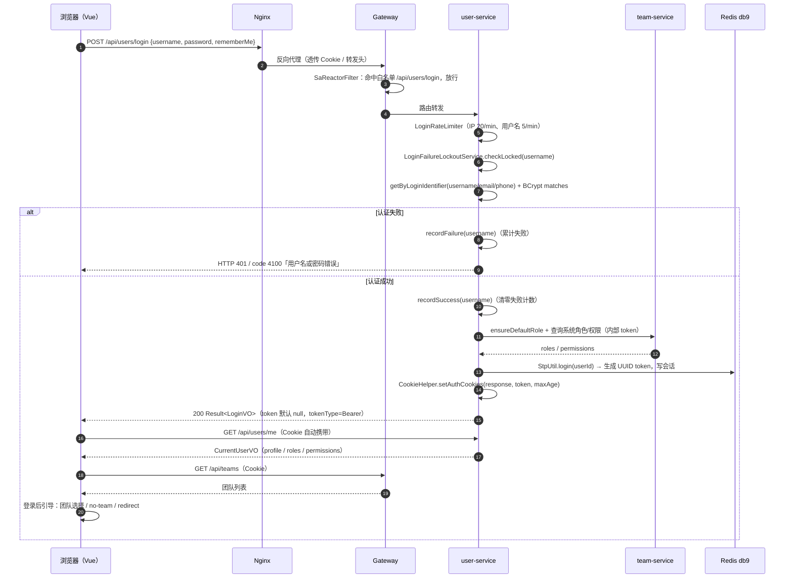
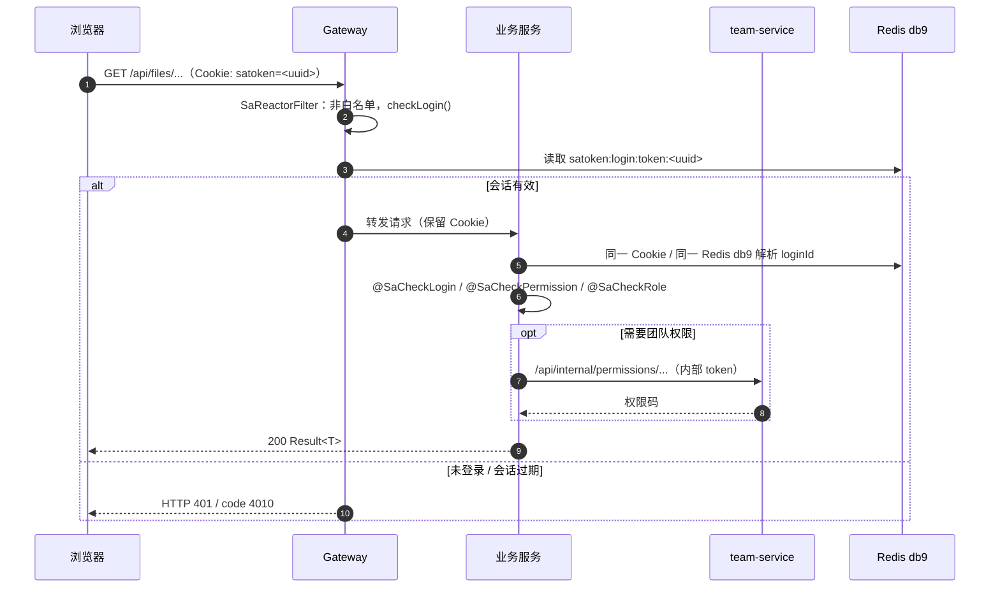
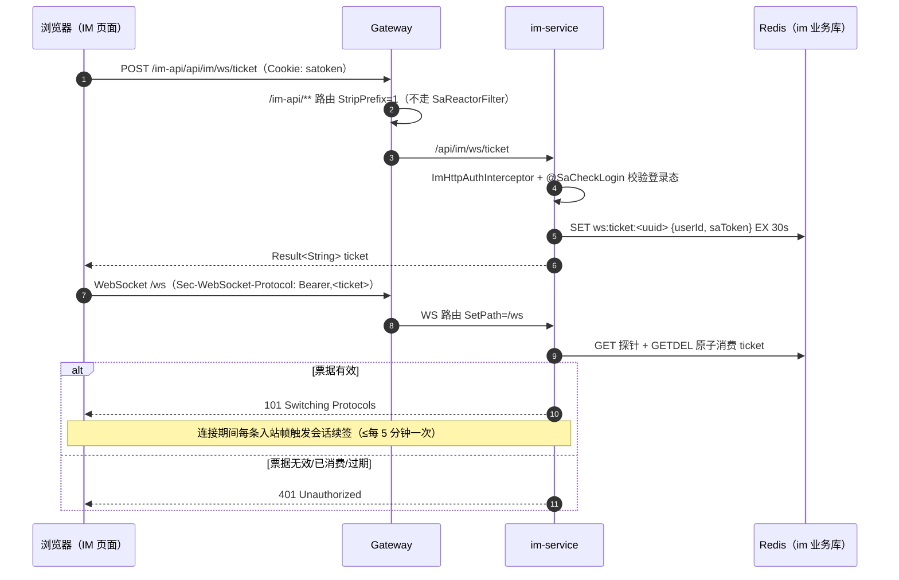

# 认证与登录全流程

> 适用仓库：`zxyz`（根仓库 `dev` 分支）
> 适用代码：`ZXYZdatabaseBack` / `ZXYZdatabaseFront` 当前工作树（2026-11-02 核对）
> 文档定位：说明项目**实际使用的认证方式**、登录全流程、请求鉴权、权限模型、会话生命周期、特殊场景，以及「JWT 记忆」的由来。

## 目录

- [0. 一句话结论](#0-一句话结论)（含与 JWT 的关键区别）
- [1. 认证体系总览](#1-认证体系总览)
- [2. 核心配置](#2-核心配置)
- [3. 登录全流程（核心）](#3-登录全流程核心)
- [4. 已登录请求的鉴权流程](#4-已登录请求的鉴权流程)
- [5. 会话生命周期](#5-会话生命周期)
- [6. 注册流程](#6-注册流程)
- [7. 特殊场景](#7-特殊场景)（记住我 / 公开分享 / IM WebSocket / 管理员桥接 / 服务间认证）
- [8. 权限与角色速查](#8-权限与角色速查)
- [9. 为什么你会记得 JWT（历史与现状）](#9-为什么你会记得-jwt历史与现状)
- [10. 安全设计与已知取舍](#10-安全设计与已知取舍)
- [11. 故障排查（Runbook）](#11-故障排查runbook)
- [12. 关键代码索引](#12-关键代码索引)
- [附录 A：错误码速查](#附录-a错误码速查)
- [附录 B：术语表](#附录-b术语表)

## 0. 一句话结论

**当前项目的业务认证不是 JWT，而是 Sa-Token 1.46.0 的 UUID Token + Redis 共享会话 + HttpOnly Cookie。**

- 登录成功后，Sa-Token 生成一个随机 UUID 作为 token，会话数据写入 Redis 独立库 **db9**（键前缀 `satoken:`）；
- 浏览器侧只通过 **HttpOnly Cookie `satoken`** 携带 token，前端不存储 token、不手动注入 `Authorization`；
- Gateway 对 `/api/**` 统一做登录态校验，业务服务再用 `@SaCheckRole` / `@SaCheckPermission` / `@RequiresTeamPermission` 做细粒度授权；
- 服务间调用使用 `X-Internal-Service-Token` + `X-Internal-Caller-Service`，与用户登录态是两套体系；
- JWT 只出现在 **Nacos 配置中心自身**的鉴权变量（`NACOS_AUTH_TOKEN`）里；业务代码在 **2025-11 ~ 2026-04** 确实用过 JWT，后来已迁移到 Sa-Token Redis 会话（详见 §9）。

### 0.1 快速对照表

| 问题 | 答案 |
|---|---|
| 登录凭证是什么 | Sa-Token UUID Token（服务端有状态，非 JWT） |
| 浏览器怎么带凭证 | HttpOnly Cookie `satoken`（`withCredentials: true`） |
| 会话存在哪里 | Redis **db9**，键前缀 `satoken:`（如 `satoken:login:token:<uuid>`） |
| 谁做第一道登录校验 | Gateway `SaReactorFilter`（`/api/**`） |
| 业务服务怎么拿当前用户 | `AuthServicePort.getCurrentUserId()` → `StpUtil.getLoginIdAsLong()` |
| 权限模型 | 系统级 RBAC + 团队级 RBAC（team-service 统一管理） |
| 服务间怎么鉴权 | `X-Internal-Service-Token` + `X-Internal-Caller-Service`（共享 token 或服务级密钥矩阵） |
| 普通会话多久过期 | 绝对 12 小时；30 分钟无操作冻结（active-timeout） |
| 记住我多久 | 7 天（绝对），且不启用 30 分钟活跃超时 |
| 退出登录做什么 | 注销当前 token + 清 `satoken` Cookie |
| JWT 在哪里 | Nacos 自身鉴权（`NACOS_AUTH_TOKEN`）；业务代码无 JWT |
| JWT 曾经用过吗 | 用过：2025-11-10 ~ 2026-04-20，见 §9 |

### 0.2 与 JWT 的关键区别

| 维度 | 传统 JWT | 本项目 Sa-Token UUID Token |
|---|---|---|
| 令牌形态 | `Header.Payload.Signature` 三段式，payload 可被 Base64 解码 | 随机 UUID，不含用户信息 |
| 校验方式 | 本地验签（无状态） | 查 Redis db9 会话（有状态） |
| 撤销能力 | 需要黑名单或等待过期 | 删除会话键即可精确撤销 |
| 会话续期 | 依赖刷新 token / 重新签发 | `active-timeout` 滑动续期 |
| 前端存储 | 常见 localStorage / Authorization Header | HttpOnly Cookie，前端不可读 |
| 本项目现状 | 仅 Nacos 自身使用 JWT 变量；业务曾用、已迁移 | **当前业务认证的实际方式** |

---

## 1. 认证体系总览

### 1.1 三层认证

| 层级 | 机制 | 作用范围 | 主要实现 |
|---|---|---|---|
| 用户认证（第一层） | Sa-Token UUID Token + Redis 会话 + HttpOnly Cookie | 浏览器 ↔ Gateway ↔ 各业务服务 | Gateway `SaTokenFilterConfig`、user-service `AuthService`/`CookieHelper` |
| 服务内授权（第二层） | Sa-Token 注解鉴权 + 团队权限 AOP | 各业务服务方法级 | `@SaCheckLogin`、`@SaCheckRole`、`@SaCheckPermission`、`@RequiresTeamPermission` |
| 服务间认证（第三层） | 内部服务 Token / 来源白名单矩阵 | 服务 ↔ 服务（`/api/internal/**`） | `InternalServiceAuthInterceptor`、`InternalAllowList`、`StripInternalHeadersFilter` |

### 1.2 参与组件与职责

| 组件 | 认证职责 |
|---|---|
| `ZXYZdatabaseFront`（Vue 3） | 登录表单、`withCredentials: true` 自动携带 Cookie、401/4010 统一处理、路由守卫、IM WS 票据获取 |
| `frontend-nginx` | 反向代理，透传 Cookie 与 `Sec-WebSocket-Protocol`；不做 Cookie 改写 |
| `zxyz-gateway` | `/api/**` 全局登录态校验；CORS；限流；剥离外部伪造的内部服务头；admin-email 桥接注入内部身份 |
| `zxyz-user-service` | 登录/注册/登出/切换账号；BCrypt 校验；登录频控与失败锁定；下发 `satoken` Cookie |
| `zxyz-common` | `AuthServicePort` 抽象与 Sa-Token 实现、`StpInterface` 远程权限实现、权限缓存、`@CurrentUser` 解析、内部服务鉴权拦截器 |
| `zxyz-team-service` | 系统角色/系统权限的唯一数据源；提供内部权限查询接口 |
| `zxyz-im-service` | IM HTTP 认证拦截器；WebSocket 一次性 Ticket 握手认证与会话续签 |
| Redis（db9） | 全站 Sa-Token 会话存储（独立于业务库 db0–db8） |
| Redis（各业务库） | 登录失败计数/锁定、登录频控、注册频控、WS 票据等业务键 |

### 1.3 一次请求的完整路径

```
浏览器
  │  ① 自动携带 Cookie: satoken=<uuid>
  ▼
Nginx（frontend-nginx）
  │  ② 反向代理，保留 Host / X-Forwarded-*，透传 Cookie
  ▼
Gateway（zxyz-gateway）
  │  ③ SaReactorFilter：/api/** 校验登录态（白名单除外）
  │     读取 Cookie → StpUtil.checkLogin() → 查 Redis db9
  ▼
业务服务（user / project / file / share / team / im / admin ...）
  │  ④ 同一个 Cookie 也在请求里；服务内 Sa-Token 读取同一 Redis db9
  │     注解鉴权：@SaCheckLogin / @SaCheckRole / @SaCheckPermission
  │     团队权限：@RequiresTeamPermission → team-service
  ▼
业务处理 → Result<T> 返回
```

> 关键点：**Gateway 不注入用户身份 Header**，各业务服务是拿同一个 `satoken` Cookie 到同一个 Redis db9 里自行解析 `loginId`。因此所有需要登录态的服务都必须正确接入 `sa-token-redis-template` + `sa-token-alone-redis` + `commons-pool2` 三件套，且共享同一份 `sa-token.alone-redis.*` 配置。

---

## 2. 核心配置

### 2.1 Sa-Token 全局配置

配置位置：`ZXYZdatabaseBack/zxyz-common/src/main/resources/application-common.yml:94-149`（所有服务共享；Nacos `zxyz-static.yml` 保存基础键的副本，但 `alone-redis` 必须只在 common 里）。

| 配置键 | 值 | 含义 |
|---|---|---|
| `sa-token.token-name` | `satoken` | Cookie / token 名称（不是 `Authorization`） |
| `sa-token.timeout` | `43200` | 普通登录绝对有效期 12 小时 |
| `sa-token.active-timeout` | `1800` | 空闲 30 分钟冻结（无操作） |
| `sa-token.is-concurrent` | `true` | 同一账号允许多端同时在线 |
| `sa-token.is-share` | `false` | 每次登录创建新 token（不共享同一 token） |
| `sa-token.token-style` | `uuid` | **UUID 令牌，不是 JWT** |
| `sa-token.is-log` | `true` | 输出 Sa-Token 操作日志（gateway 本地覆盖为 `false`） |
| `sa-token.is-read-cookie` | `true` | 从 `satoken` Cookie 读取 token |
| `sa-token.dynamic-active-timeout` | `true` | active-timeout 随活跃状态动态生效 |
| `sa-token.alone-redis.pattern` | `single` | 会话独立 Redis 连接（单机） |
| `sa-token.alone-redis.database` | `9` | **会话统一落 db9（硬编码）** |
| `sa-token.alone-redis.timeout` | `3s` | 连接超时 |
| `sa-token.alone-redis.lettuce.pool` | max-active 8 / max-idle 8 / min-idle 2 | 连接池 |

> ⚠️ 为什么 `alone-redis` 必须写在 `application-common.yml`：Gateway 只 import `application-common.yml` + `zxyz-dynamic.yml`，**不 import** `nacos-config/zxyz-static.yml`。写到 static 会出现「业务服务写 db9、gateway 校验读 db0」→ 登录成功但下一请求 401。完整推演见 `application-common.yml:110-135` 注释与 `docs/redis-session-layout.md`。

### 2.2 Cookie 与超时配置

| 配置键 | 值（默认） | 说明 |
|---|---|---|
| `app.auth.secure` / `AUTH_COOKIE_SECURE` | `false` | Cookie 的 `Secure` 标志；当前部署为 IP 直连 HTTP，置 true 会导致浏览器不回传 Cookie、登录失效 |
| `app.auth.domain` / `AUTH_COOKIE_DOMAIN` | 空 | Cookie 的 `Domain`；为空时 host-only |
| `app.auth.token-timeout-seconds` / `AUTH_TOKEN_TIMEOUT` | `43200`（12h） | 普通登录 Cookie Max-Age |
| `app.auth.long-lived-timeout-seconds` / `AUTH_LONG_LIVED_TIMEOUT` | `604800`（7d） | 记住我 Cookie Max-Age |
| `app.security.return-token-in-body` | `false` | 登录/切号响应体是否回传 token；仅 dev profile 打开 |

Cookie 实际属性（`CookieHelper.setAuthCookies`，`ZXYZdatabaseBack/zxyz-user-service/src/main/java/uno/acloud/user/config/CookieHelper.java:37-49`）：

| 属性 | 值 |
|---|---|
| Name | `satoken` |
| HttpOnly | `true` |
| Path | `/` |
| Max-Age | normal 43200 秒 / rememberMe 604800 秒 |
| Secure | `app.auth.secure`（默认 `false`） |
| SameSite | `Lax`（硬编码） |
| Domain | `app.auth.domain`（为空则不设置） |

> **Cookie 双写说明**：`is-read-cookie=true` 时，Sa-Token 在 `StpUtil.login()` 内部会先写一枚框架默认 Cookie；随后 `UserController.login` 调用 `CookieHelper.setAuthCookies` 写入属性完整的权威 Cookie。两枚同名 Cookie 的值相同、属性不同（框架默认可能不带 `HttpOnly`/`Secure`，且默认 Path 行为可能与 `/` 不同）。当前依赖调用顺序保证 `CookieHelper` 在 `StpUtil.login` 之后执行；**若调整调用顺序，HttpOnly 防护可能静默失效**（见 `CookieHelper.java:21-36` 注释）。建议用真实登录响应头 `Set-Cookie` 做一次验证。

### 2.3 Gateway 鉴权白名单

`ZXYZdatabaseBack/zxyz-gateway/src/main/java/uno/acloud/gateway/filter/SaTokenFilterConfig.java:45-78`：

- `SaReactorFilter` 拦截范围：`/api/**`
- 排除：`/actuator/**`
- `OPTIONS` 预检：直接放行（CORS 预检不携带登录态）
- 白名单（无需登录）：
  - `/api/users/login`
  - `/api/users/register`
  - `/api/public/shares/**`
- 其余 `/api/**`：`authServicePort.checkLogin()`
- `/api/internal/**`：**公网拒绝**，抛出 `NotPermissionException` → HTTP 403
- 异常返回：
  - 未登录/过期：HTTP 401，`{"code":4010,"msg":"未登录或登录已过期","data":null}`
  - 无权限：HTTP 403，`{"code":4030,"msg":"没有权限","data":null}`

> Gateway 的过滤范围只有 `/api/**`。`/im-api/**` 与 `/ws` 不走这个 SaReactorFilter：IM HTTP 由 im-service 的 `ImHttpAuthInterceptor` + `@SaCheckLogin` 保护；WebSocket 由一次性 Ticket 握手认证保护（见 §7.3）。

### 2.4 认证相关环境变量

| 变量 | 用途 | 注入位置 |
|---|---|---|
| `REDIS_HOST` / `REDIS_PORT` / `REDIS_PASSWORD` | 主 Redis 与会话 Redis 同源连接 | 各服务 |
| `REDIS_DATABASE` | 各服务业务库号（gateway 0 / project 1 / im 2 / email 3 / user 4 / share 5 / file 6 / team 7 / audit 8） | 各服务 |
| `AUTH_COOKIE_SECURE` / `AUTH_COOKIE_DOMAIN` / `AUTH_TOKEN_TIMEOUT` / `AUTH_LONG_LIVED_TIMEOUT` | Cookie 属性与超时 | 仅 user-service（Cookie 签发方） |
| `INTERNAL_SERVICE_TOKEN` | 服务间共享 token（过渡模式） | 各服务 + gateway |
| `SVC_*_KEY` | 服务级白名单矩阵的每服务独立密钥 | 各服务 + gateway |
| `NACOS_AUTH_TOKEN` / `NACOS_AUTH_IDENTITY_KEY` / `NACOS_AUTH_IDENTITY_VALUE` | **仅 Nacos 自身**的 JWT 签名密钥与身份 | 仅 Nacos 容器 |

---

## 3. 登录全流程（核心）

### 3.1 时序图



### 3.2 阶段一：前端提交

1. 用户访问 `/login`，表单字段只有 `username`、`password`、`rememberMe`（文案「7 天免登录」），见 `ZXYZdatabaseFront/src/composables/useLoginForm.js:15-19`、`ZXYZdatabaseFront/src/views/login/index.vue:38-40`。
2. 登录页当前**没有登录按钮**：唯一提交方式是 document 上的 Enter 监听（`ZXYZdatabaseFront/src/views/login/index.vue:77-93`）；鼠标/触屏用户无法直接提交，这是现状实现细节（见 §10.2）。
3. 提交调用 `currentUserStore.login(payload)` → `POST /api/users/login`（`ZXYZdatabaseFront/src/store/currentUser.js:155-169`、`ZXYZdatabaseFront/src/api/auth.js:7-9`）。
4. 前端所有 Axios 实例均 `withCredentials: true`，浏览器自动携带同源 Cookie；请求拦截器**不注入 Authorization**（`ZXYZdatabaseFront/src/utils/createApiClient.js:146-170`）。

### 3.3 阶段二：Gateway 放行

- `/api/users/login` 在 `SaTokenFilterConfig` 白名单内，直接放行（不要求已登录）。
- `OPTIONS` 预检直接放行，避免 CORS 预检因无 Cookie 被 401。
- 真实客户端 IP 由 `ClientIpFilter` 统一解析：先删除客户端自带的 `X-Real-IP` / `X-Forwarded-For`，仅在配置可信代理时覆盖式写入 `X-Real-IP`；限流与下游安全逻辑只信任网关解析结果（`ZXYZdatabaseBack/zxyz-gateway/src/main/java/uno/acloud/gateway/filter/ClientIpFilter.java:43-65`）。
- Gateway 默认全局限流：`RequestRateLimiter`，`replenishRate` 50、`burstCapacity` 100，key 为真实客户端 IP（`ZXYZdatabaseBack/zxyz-gateway/src/main/resources/application.yml:43-48`；`SaTokenFilterConfig.java:99-121`）。

### 3.4 阶段三：user-service 校验

`UserController.login`（`ZXYZdatabaseBack/zxyz-user-service/src/main/java/uno/acloud/user/controller/UserController.java:97-120`）按顺序执行：

1. **解析真实 IP**：`ClientIpUtil.resolve(httpRequest)`，优先 `X-Real-IP`，否则 `getRemoteAddr()`（`ZXYZdatabaseBack/zxyz-common/src/main/java/uno/acloud/common/web/ClientIpUtil.java:37-57`）。
2. **登录频控**：`LoginRateLimiter.checkAndIncrement(ip, username)`（`ZXYZdatabaseBack/zxyz-user-service/src/main/java/uno/acloud/user/service/impl/LoginRateLimiter.java:33-36`）：
   - IP 维度：`zxyz:user:login:ip:<ip>`，20 次/分钟；
   - 用户名维度：`zxyz:user:login:username:<username>`，5 次/分钟；
   - 固定 1 分钟窗口（首次请求起算）；超限抛 `BAD_REQUEST`（4000，HTTP 400）。
3. **调用 `AuthService.login(request)`**（`ZXYZdatabaseBack/zxyz-user-service/src/main/java/uno/acloud/user/service/impl/AuthService.java:42-66`）：
   1. `loginFailureLockoutService.checkLocked(username)`：锁定期间直接拒绝（`LOGIN_LOCKED` 4102 / HTTP 429），不泄露密码是否正确；
   2. `userMapper.getByLoginIdentifier(username)`：支持 **用户名、已验证邮箱、已验证手机号** 三种登录标识（`ZXYZdatabaseBack/zxyz-user-service/src/main/java/uno/acloud/user/mapper/UserMapper.java:61-70`）；
   3. `UserQueryHelper.passwordMatched(rawPassword, dbUser)`：`BCryptPasswordEncoder.matches(...)`（`ZXYZdatabaseBack/zxyz-user-service/src/main/java/uno/acloud/user/service/impl/UserQueryHelper.java:74-80`；Encoder 见 `.../user/config/SecurityConfig.java:9-14`）；
   4. 失败：`recordFailure(username)` 累计失败（含用户名不存在的尝试，防枚举），抛 `LOGIN_FAILED`（4100 / HTTP 401，文案「用户名或密码错误」）；
   5. 成功：`recordSuccess(username)` 清零失败计数；
   6. `teamServicePermissionClient.ensureDefaultRole(userId, username)`：确保默认系统角色；异常会中断登录；
   7. `getSystemRolesByUserId` / `getSystemPermissionsByUserId`：查询系统角色与权限；这两个查询失败时**降级为空集合**（仍可能登录成功但会话权限为空）；
   8. `authSessionService.createLoginSession(userId, username, roles, permissions, rememberMe)`。
4. **注意（现状）**：登录链路**没有验证码校验**、**没有账号状态/禁用检查**、**没有更新 `last_login_time`**。登录请求字段不含验证码（`ZXYZdatabaseBack/zxyz-user-service/src/main/java/uno/acloud/user/dto/LoginRequest.java:19-30`）；`user` 表无 status/enabled 列（`V1__init_schema.sql:7-25`）。

### 3.5 阶段四：创建 Sa-Token 会话

`SaTokenAuthSessionService.createLoginSession`（`ZXYZdatabaseBack/zxyz-user-service/src/main/java/uno/acloud/user/satoken/SaTokenAuthSessionService.java:31-42`）：

1. 计算 `timeoutSeconds = rememberMe ? longLivedTimeoutSeconds : tokenTimeoutSeconds`；
2. `authServicePort.login(userId, timeoutSeconds, rememberMe ? -1 : -2)`：
   - 普通登录：`activeTimeout = -2`（哨兵值）→ 不设置模型级 activeTimeout，跟随全局 `1800` 秒（30 分钟无操作冻结）；
   - `rememberMe=true`：`activeTimeout = -1` → 禁用活跃超时；绝对有效期 7 天；
3. 写入会话属性：`userId`、`username`、`role`（List<String>）、`permission`（List<String>）；
4. 返回 `StpUtil.getTokenValue()` 生成的 UUID token。

底层 `SaTokenAuthServicePort.login` 构建 `SaLoginModel` 后调用 `StpUtil.login(userId, model)`（`ZXYZdatabaseBack/zxyz-common/src/main/java/uno/acloud/satoken/SaTokenAuthServicePort.java:64-74`）。Sa-Token 使用 `sa-token-redis-template` + `sa-token-alone-redis-by-spring-boot4` 把会话写入 Redis **db9**。

### 3.6 阶段五：下发 Cookie

`UserController.login` 在 `authService.login()` 返回后：

1. 根据 `rememberMe` 选择 Cookie Max-Age（普通 43200 秒 / 记住我 604800 秒）；
2. `cookieHelper.setAuthCookies(response, token, cookieMaxAge)`；
3. `LoginVO`：`token` 字段默认 `null`（`app.security.return-token-in-body=false`），`tokenType` 固定 `"Bearer"`，`isLogin=true`；
4. 仅 dev profile 打开 `return-token-in-body=true`，此时 body 里能看到 token（本地联调/文档调试用），生产必须保持关闭。

### 3.7 阶段六：前端登录后引导

1. `currentUserStore.login` 在登录成功后立即 `GET /api/users/me` 拉完整 profile（含 roles/permissions），避免路由守卫读到旧状态（`ZXYZdatabaseFront/src/store/currentUser.js:155-169`）。
2. `usePostLoginGuide.handlePostLoginSuccess`（`ZXYZdatabaseFront/src/composables/usePostLoginGuide.js:28-50`）：
   - `sessionStore.ensureSessionReady({ force: true })`：重新加载 `/me` + 团队列表；
   - 若团队数 ≥ 2 且没有默认团队：弹出团队选择对话框（`TeamSelectDialog`）；
   - 若 `shouldEnterNoTeam`（无团队且非系统管理员）：跳 `/no-team`；
   - 否则 `sanitizeRedirectPath(route.query.redirect)` 后 `router.replace(redirect)`（默认 `/index`）。
3. 路由守卫 `beforeEach`（`ZXYZdatabaseFront/src/router/index.js:167-203`）：非公开路由若无 `currentUserStore.profile` → 登录页并带 `redirect`；已登录后 `ensureSessionReady()`；401/403 时清理状态并回登录页。

### 3.8 登录失败分支速查

| 场景 | 错误码 | HTTP | 文案/说明 |
|---|---|---|---|
| 用户名/密码错误（含用户不存在） | `LOGIN_FAILED` 4100 | 401 | 用户名或密码错误 |
| 账号处于失败锁定窗口 | `LOGIN_LOCKED` 4102 | 429 | 失败次数过多，账号已临时锁定，请稍后再试 |
| 登录频控超限（IP 或用户名） | `BAD_REQUEST` 4000 | 400 | 请求过于频繁，请稍后再试 |
| 参数校验失败 | `BAD_REQUEST` 4000 | 400 | 具体字段校验信息 |
| 未登录/会话过期（后续请求） | `NO_LOGIN` 4010 | 401 | 未登录或登录已过期 |
| 无权限（注解鉴权失败） | `NO_PERMISSION` 4030 | 403 | 无操作权限/无角色权限 |

### 3.9 登录失败锁定与频控（互补关系）

| 机制 | 维度 | 默认参数 | Redis 键 | 作用 |
|---|---|---|---|---|
| `LoginRateLimiter` | IP + 用户名 | IP 20/min、用户名 5/min | `zxyz:user:login:ip:*`、`zxyz:user:login:username:*` | 拦「快」：短时间高频请求 |
| `LoginFailureLockoutService` | 用户名 | 5 次 / 15 分钟窗口 / 锁 30 分钟 | `zxyz:auth:fail:<username>`、`zxyz:auth:lock:<username>` | 拦「慢」：持续撞库 |

- 锁定服务默认 `enabled=false`（`application.yml`），**生产 profile 显式开启**（`application-prod.yml:14-17`）；
- 失败窗口是「从该用户名第一次失败起算固定 15 分钟」，不是每次失败重置；
- 锁定标记不主动删除，按 TTL 自然过期；登录成功只清失败计数，不清锁定标记；
- 已知取舍：按用户名锁定可被攻击者蓄意锁他人账号（`docs/known-limitations.md §6`）。

---

## 4. 已登录请求的鉴权流程

### 4.1 时序图



### 4.2 Gateway 层

- 所有 `/api/**`（除白名单、`/actuator/**`、OPTIONS）都先过 `checkLogin()`；
- `checkLogin()` 的实际实现是 `StpUtil.checkLogin()`（`ZXYZdatabaseBack/zxyz-common/src/main/java/uno/acloud/satoken/SaTokenAuthServicePort.java:22-25`）；
- Sa-Token 从 `satoken` Cookie 读 token，再到 Redis db9 查会话；
- 校验失败返回 HTTP 401 + `code 4010`；`/api/internal/**` 直接 403 + `code 4030`，防止公网直连内部端点；
- 网关**不做**用户身份 Header 注入，也不向上游传递 `Authorization`；上游服务自己解析 Cookie。

### 4.3 业务服务层

各 HTTP 业务服务都配置 `SaTokenConfigure`（示例 `ZXYZdatabaseBack/zxyz-user-service/src/main/java/uno/acloud/user/config/SaTokenConfigure.java:24-37`；audit-service 为纯 MQ 消费者、无 HTTP 端点，不参与）：

- 注册 `SaInterceptor`，拦截 `/**`，排除 `/actuator/**`、`/api/internal/**` 以及登录/注册等公开端点；
- `new SaInterceptor()` 默认只执行 `@SaCheck*` **注解鉴权**，不强制所有路径登录（登录校验由 Gateway 层统一完成）；
- `@CurrentUser Long userId` 由 `CurrentUserArgumentResolver` 解析为 `authServicePort.getCurrentUserId()`（`ZXYZdatabaseBack/zxyz-common/src/main/java/uno/acloud/common/web/CurrentUserArgumentResolver.java:24-28`）。

常用注解：

| 注解 | 用途 |
|---|---|
| `@SaCheckLogin` | 要求已登录（IM 控制器类级常用） |
| `@SaCheckRole("system_admin")` | 要求系统角色（admin 类接口） |
| `@SaCheckPermission("file:upload")` | 要求系统权限码（file/share/im 等） |
| `@RequiresTeamPermission(...)` | 要求团队级权限（AOP，见 `TeamPermissionAspect`） |

### 4.4 当前用户身份解析

`AuthServicePort.getCurrentUserId()` → `StpUtil.getLoginIdAsLong()`（`ZXYZdatabaseBack/zxyz-common/src/main/java/uno/acloud/satoken/SaTokenAuthServicePort.java:17-20`）。

`@CurrentUser` 注解（`ZXYZdatabaseBack/zxyz-common/src/main/java/uno/acloud/common/web/CurrentUser.java`）与 `CurrentUserArgumentResolver` 让 Controller 不直接依赖 `StpUtil` 静态方法；未登录抛 `NotLoginException`，由 `GlobalExceptionHandler` 转成 401/4010（`ZXYZdatabaseBack/zxyz-common/src/main/java/uno/acloud/common/GlobalExceptionHandler.java:42-47`）。

### 4.5 权限模型

**系统级 RBAC（team-service 统一管理）：**

- 系统角色：`system_admin`、`system_user`（`SystemRoleCodes`）；
- 系统权限码：`system:access`、`file:upload/read/write/delete`、`folder:create`、`trash:read`、`share:create/read/manage`、`im:file-card`、`system:role:manage`、`system:permission:read`、`system:audit:read`、`team:create` 等（`SystemPermissionCodes`）。

**团队级 RBAC：**

- 团队角色：`team_owner`、`team_admin`、`team_member` 及自定义角色；
- 团队权限码：`team:view/update`、`team:member:*`、`team:announcement:publish`、`team:mute:manage`、`team:invite-link:manage`、`team:join-request:review`、`team:role:manage`、`team:permission:read`、`team:audit:read`、`team:project:manage`、`team:file:read/write/delete`、`team:storage:allocate` 等。

**权限查询链路：**

```
@SaCheckPermission / @SaCheckRole
  → Sa-Token StpInterface
  → RemoteStpInterfaceImpl（zxyz-common）
  → PermissionCache（Caffeine，TTL 5 分钟，max 2000）
  → team-service
     GET /api/internal/permissions/user/system-permissions/{userId}
     GET /api/internal/permissions/user/system-roles/{userId}
     带 X-Internal-Service-Token + X-Internal-Caller-Service
```

- `RemoteStpInterfaceImpl` 见 `ZXYZdatabaseBack/zxyz-common/src/main/java/uno/acloud/satoken/RemoteStpInterfaceImpl.java:48-121`；
- `PermissionCache` 见 `ZXYZdatabaseBack/zxyz-common/src/main/java/uno/acloud/satoken/PermissionCache.java:22-89`；
- 权限变更通过 Redis Pub/Sub `zxyz:permission:changed` 失效缓存（`PermissionCache.INVALIDATION_TOPIC`）；另有团队级 `TeamPermissionLocalCache`（TTL 5 分钟、max 10000、频道 `zxyz:team-permission:changed`）；
- `StpInterface` 实现分布：team-service 使用本地库实现（`StpInterfaceImpl`）；file-service、share-service 继承 `RemoteStpInterfaceImpl` 做定制；user/im/email/admin/project 走 `RemoteStpInterfaceAutoConfig` 的默认 Bean；
- team-service 不可用时，若权限缓存有旧值则降级使用旧值，否则抛 `SYSTEM_ERROR`。

**团队权限（`@RequiresTeamPermission`）：**

- 注解仅支持方法级；`TeamPermissionAspect` 从方法参数解析 `teamId`，取当前用户后调用 `TeamPermissionPort.check(userId, teamId, permissionCode)`（`ZXYZdatabaseBack/zxyz-common/src/main/java/uno/acloud/common/permission/TeamPermissionAspect.java:24-38`）；
- file-service / project-service 的 `TeamServicePermissionClient` 分别调用 team-service 内部接口 `POST /api/internal/permissions/check` / `/has`（带内部服务头）；
- team-service 本服务内使用本地 `TeamFileAccessService implements TeamFileAccessPort`。

> 权限体系由 team-service 统一管理，其他服务只查询不存储；详见 `docs/architecture.md` 与 `docs/claude-backend.md`。

---

## 5. 会话生命周期

### 5.1 有效期与续期

| 会话类型 | 绝对有效期 | 空闲超时 | 说明 |
|---|---|---|---|
| 普通登录 | 12 小时（43200s） | 30 分钟（1800s） | 每次有访问会刷新 `last-active`；30 分钟无操作冻结，需要重新登录 |
| 记住我（rememberMe） | 7 天（604800s） | 不启用（activeTimeout=-1） | 7 天内即使长时间不操作也不会因空闲失效 |

- `dynamic-active-timeout: true` 让 `active-timeout` 按最近活跃时间动态计算；
- 普通 HTTP 请求只要触发 Sa-Token 的 `getLoginId()` / `getTokenSession()` 等会话访问，就会被动续期；
- **IM WebSocket 例外**：WS 握手用的 `getLoginIdByToken(token)` 不在 Sa-Token 被动续签清单，且握手后 Netty 管道内没有 Sa-Token 调用。因此 im-service 在 WS 连接存活期间主动续签：每条入站帧（业务消息帧 + PING）触发 `ImSessionKeepAliveService.renew(...)`，同一连接两次续签间隔 < 5 分钟则跳过；调用 `StpUtil.stpLogic.updateLastActiveToNow(tokenValue)`（详见 `docs/architecture.md:51-67` 与 `ZXYZdatabaseBack/zxyz-im-service/src/main/java/uno/acloud/im/application/ImSessionKeepAliveService.java`）。

### 5.2 过期表现为 401

- Gateway `SaTokenFilterConfig` 捕获异常返回 `{"code":4010,"msg":"未登录或登录已过期"}`；
- 业务服务内 `NotLoginException` 由 `GlobalExceptionHandler` 转成 401/4010；
- 前端主 `request` 实例对 HTTP 401/业务码 4010 统一处理：清 profile → `ElMessageBox.alert('登录状态已过期，请重新登录')` → `window.location.replace('/login?redirect=...')`（`ZXYZdatabaseFront/src/utils/createApiClient.js:78-131`）；
- 附属实例（`publicRequest`/`imRequest`，`onTokenExpired:'silent'`）只提示一次，不清主应用登录态、不跳转。

### 5.3 退出登录

`POST /api/users/logout`（`ZXYZdatabaseBack/zxyz-user-service/src/main/java/uno/acloud/user/controller/UserController.java:122-128`）：

1. `authServicePort.logout()` → `StpUtil.logout()`（注销**当前 token**，不影响同账号其他设备会话）；
2. `CookieHelper.clearAuthCookies(response)` → 清 `satoken` Cookie（Max-Age 0）；
3. 前端 `layout/index.vue:218-235`：断开 IM WS → 调用 logout API → `sessionStore.resetSessionBootstrap()` → `currentUserStore.clearAll()` → `router.replace({name:'login', redirect: ...})`。

> ⚠️ 现状注意：前端 logout API 失败会被静默忽略（`catch {}`），本地状态仍被清空；若服务端没清理成功，浏览器里的 HttpOnly Cookie 可能仍然有效，刷新后可能恢复会话（见 §10.2）。

### 5.4 多端与账号切换

- `is-concurrent: true` + `is-share: false`：同一账号每次登录生成独立 token，多端会话并存；
- 切换关联账号：`POST /api/users/linked-accounts/{targetUserId}/switch`
  - 目标账号必须与当前账号存在已验证的同一联系方式；
  - 首次切换需通过目标账号密码建立信任（`POST .../trust`）；
  - 后端先 `logout(targetId)` 踢掉目标账号旧会话，再创建新会话并下发新 Cookie；
  - 返回 `AccountSwitchVO`（profile + token；生产 token 置 null）；
  - **当前账号的旧会话不会在切换时注销**（直到自然过期），见 `AccountLinkingService.switchLinkedAccount`。

### 5.5 会话可视化与排查

```bash
# 登录一次后，在 Redis db9 看到会话键
docker exec zxyz-redis redis-cli -n 9 --scan --pattern 'satoken*'
# 期望：非空（例如 satoken:login:token:<uuid>）
# 反例：db0–db8 出现 satoken 键 → 会话落错库
docker exec zxyz-redis redis-cli -n 0 --scan --pattern 'satoken*'
```

> 判断是「非空」不是「等于 N 个」——键数随在线用户自然波动。

---

## 6. 注册流程

1. `POST /api/users/register`（Gateway 白名单，无需登录）；
2. `RegisterRateLimiter.checkAndIncrement(ip)`：默认每 IP 每小时 3 次（`ZXYZdatabaseBack/zxyz-user-service/src/main/java/uno/acloud/user/service/impl/RegisterRateLimiter.java:20-34`）；
3. `AuthService.register`：
   - 构造 `User`（仅 username + 原始 password）；
   - `passwordEncoder.encode(password)` → BCrypt hash 后入库；
   - 用户名唯一键 `uk_user_username` 冲突 → `USERNAME_EXISTS`（4101 / HTTP 409）；
   - 插入成功后调用 `teamServicePermissionClient.ensureDefaultRole(userId, username)`；角色分配失败抛 `SYSTEM_ERROR`，但用户记录已插入（方法无事务）；
4. 密码策略：长度 8–128，必须同时含字母与数字（`PasswordPolicy`）；用户名 2–64 字符；
5. **没有验证码、没有邮箱验证**；注册接口是公网白名单路径（`AuthService.java:74-80` 注释明确说明）；
6. **没有「首个注册用户成为管理员」分支**：管理员由 `AdminBootstrapRunner` 在部署时按 `ADMIN_INIT_USERNAME` / `ADMIN_INIT_PASSWORD` 创建；
7. 前端注册页字段 username / password / confirmPassword，成功后提示「注册成功，请登录」并跳 `/login`（`ZXYZdatabaseFront/src/views/register/index.vue`）。

> 注意：前端用户名校验 3–20 字符，后端 2–64；密码前端无最大长度，后端 8–128（见 §10.2）。

---

## 7. 特殊场景

### 7.1 记住我（7 天免登录）

- 前端复选框文案「7 天免登录」，字段 `rememberMe`；
- 后端 `LoginRequest.rememberMe` 默认 false；
- `rememberMe=true` 时：Sa-Token `timeout=604800`（7 天绝对），`activeTimeout=-1`（不做 30 分钟空闲超时）；Cookie Max-Age=604800；
- 普通登录：`timeout=43200`（12 小时），`activeTimeout` 跟随全局 1800（30 分钟）。

### 7.2 公开分享（免登录）

- 路由 `/s/:shareKey`（`sharePublic`）是前端公开路由；
- Gateway 白名单 `/api/public/shares/**`；
- 前端公开分享接口使用 `publicRequest`（5s 超时、`onTokenExpired:'silent'`）；
- 分享访问密码校验使用分享服务自己的机制（`SHARE_COOKIE_SECRET` HMAC 签名 Cookie，`ShareTokenCodec`），**不是用户登录态**；
- 公开分享 401 不清主应用登录态、不跳登录页（silent 实例策略）。

### 7.3 IM WebSocket 认证（一次性 Ticket）



- Ticket 端点：前端调用 `POST /im-api/api/im/ws/ticket`（Gateway `StripPrefix=1` 后为 im-service 的 `POST /api/im/ws/ticket`），`@SaCheckLogin`（`ZXYZdatabaseBack/zxyz-im-service/src/main/java/uno/acloud/im/controller/WsTicketController.java:14,31-36`）；
- Ticket 存储：Redis `ws:ticket:<uuid>`，TTL 默认 30 秒（`ImProperties.ticketTtlSeconds`），内容 `{userId, saToken}`；
- 消费：先 `GET` 探针、解析成功后才 `GETDEL` 原子消费（`WsTicketService.java:80-121`），防止「票据有效却被 401 且票据已销毁」；
- 握手：`ImWebSocketAuthHandler` 从 `Sec-WebSocket-Protocol` 中找 `Bearer`，取下一个值作为 ticket；生产环境只接受 ticket，dev 才允许 raw Sa-Token fallback（`ImWebSocketAuthHandler.java:33-93`）；
- 前端：`fetchWsTicket()` → `new WebSocket(url, ['Bearer', ticket])`（`ZXYZdatabaseFront/src/utils/imWebSocket.js:51-54,202`）。

### 7.4 管理员与内部桥接

| 路径 | 认证方式 |
|---|---|
| `/api/admin/email/**` | Gateway 重写为 `/api/email/internal/**`，并注入 `X-Internal-Service-Token`（`SVC_GATEWAY_KEY` 优先，回退 `INTERNAL_SERVICE_TOKEN`）+ `X-Internal-Caller-Service: zxyz-gateway`；email-service `EmailInternalAuthInterceptor` 校验内部 token，管理端点再叠加 `@SaCheckRole('system_admin')` |
| `/api/admin/database/**` | 由 project-service 的 Sa-Token 登录态 + `@SaCheckRole('system_admin')` 把关；**不注入内部 token**（有意为之） |
| `/api/admin/**`（通用） | admin-service；`ConfigAdminController` 类级 `@SaCheckRole('system_admin')` |
| `/api/internal/**` | 公网一律 403；仅 Docker 内网服务间直连，`InternalServiceAuthInterceptor` 校验 `X-Internal-Service-Token` + `X-Internal-Caller-Service` |

### 7.5 服务间认证（第三层）细节

- Header：`X-Internal-Service-Token`、`X-Internal-Caller-Service`；
- `InternalServiceAuthInterceptor` 只注册在 `/api/internal/**`（示例 `zxyz-user-service/.../SaTokenConfigure.java:26-27`）；
- 两种模式：
  1. **过渡模式（默认）**：`app.internal.allowed-sources` 为空，校验共享 `INTERNAL_SERVICE_TOKEN`；
  2. **矩阵模式**：`app.internal.allowed-sources` 配置 `允许来源服务名 -> 独立密钥`，按来源校验；
- Gateway `StripInternalHeadersFilter` 无条件剥离外部请求伪造的 `X-Internal-Service-Token`、`X-Internal-Caller-Service`、`X-Acting-User-Id`，只允许网关自身 admin 桥接再补回受信身份（`ZXYZdatabaseBack/zxyz-gateway/src/main/java/uno/acloud/gateway/filter/StripInternalHeadersFilter.java:37-52`）；
- 服务间 HTTP 调用由 `*ServiceClient` / `AbstractServiceClient` 自动带内部头；
- 详见 `docs/matrix-enable-guide.md`、`docs/claude-backend.md` 的「服务间接口设计规范」。

---

## 8. 权限与角色速查

### 8.1 系统权限码（节选）

| 权限码 | 含义 |
|---|---|
| `system:access` | 系统访问 |
| `file:upload` / `file:read` / `file:write` / `file:delete` | 文件操作 |
| `folder:create` | 文件夹创建 |
| `trash:read` | 回收站查看 |
| `share:create` / `share:read` / `share:manage` | 分享操作 |
| `im:file-card` / `im:conversation:read` / `im:conversation:create` / `im:message:read` / `im:message:send` | IM 操作 |
| `system:role:manage` / `system:permission:read` / `system:audit:read` | 系统管理 |
| `team:create` | 团队创建 |

### 8.2 团队权限码（节选）

| 权限码 | 含义 |
|---|---|
| `team:view` / `team:update` | 团队查看/更新 |
| `team:member:view` / `team:member:create` / `team:member:invite` / `team:member:assign-role` / `team:member:remove` | 成员管理 |
| `team:announcement:publish` | 公告发布 |
| `team:mute:manage` | 禁言管理 |
| `team:invite-link:manage` | 邀请链接管理 |
| `team:join-request:review` | 加入申请审核 |
| `team:role:manage` / `team:permission:read` / `team:audit:read` | 权限管理 |
| `team:project:manage` | 项目管理 |
| `team:file:read` / `team:file:write` / `team:file:delete` | 团队文件操作 |
| `team:storage:allocate` | 存储分配 |

### 8.3 关键注解使用点（节选）

| 服务 | 位置 | 注解 |
|---|---|---|
| user-service | `UserController.deleteUser` | `@SaCheckRole(SYSTEM_ADMIN)` |
| file-service | `FileController`、`FolderController`、`TrashController`、`ImFileCardController` | `@SaCheckPermission(FILE_*)` |
| share-service | `ShareController` | `@SaCheckPermission(SHARE_*)` |
| im-service | `ConversationController`、`MessageController`、`TeamCollaborationController`、`WsTicketController` | `@SaCheckLogin` / `@SaCheckPermission(IM_*)` |
| project-service | `ProjectMemberController`、`ProjectCreateRequestController`、`ProjectCatalogController` | `@SaCheckPermission(PROJECT_*)` |
| team-service | `AdminTeamController`、`SystemPermissionController` | `@SaCheckRole(SYSTEM_ADMIN)` |
| email-service | `EmailInternalController` | `@SaCheckRole(SYSTEM_ADMIN)` |
| admin-service | `ConfigAdminController`（类级） | `@SaCheckRole(SYSTEM_ADMIN)` |

> 注解只有在 `SaInterceptor` 生效的服务里才会执行；`SaTokenConfigure` 未注册或 `StpInterface` Bean 缺失会导致 `@SaCheckRole`/`@SaCheckPermission` 报 4030（历史事故根因，见 `RemoteStpInterfaceAutoConfig` 注释）。

---

## 9. 为什么你会记得 JWT（历史与现状）

**结论：你没有记错——项目确实用过 JWT，但已在 2026-04-20 前后完成向 Sa-Token Redis 会话的迁移。当前业务认证不是 JWT。**

### 9.1 当前 JWT 的唯一存在：Nacos 自身鉴权

- `NACOS_AUTH_TOKEN` 是 Nacos 服务端的 JWT 签名密钥（Base64 编码、解码后 ≥ 32 字节），只注入 `nacos` 容器（`docker-compose.yml:212-215`、`.env.example:225-229`）；
- `NACOS_AUTH_IDENTITY_KEY` / `NACOS_AUTH_IDENTITY_VALUE` 是 Nacos 的 server identity；
- 当前 `nacos.core.auth.enabled=false`（`DEPLOYMENT.md:381`），即 Nacos 鉴权本身尚未开启；
- 业务服务不消费这些变量。

### 9.2 父 pom 里的 `sa-token-jwt` 是历史残留

- `ZXYZdatabaseBack/pom.xml:212-216` 位于 `<dependencyManagement>`，只是版本声明；
- 全仓**没有任何模块**在 `<dependencies>` 中声明 `sa-token-jwt`；
- 当前无 `JwtUtil` / `SaJwtUtil` / `StpLogicJwt` / `jwt-secret-key` / `jjwt` 代码或配置；
- 实际配置：`token-style: uuid`（`ZXYZdatabaseBack/zxyz-common/src/main/resources/application-common.yml:105`）。

### 9.3 历史时间线（后端仓库）

| 日期 | 提交 | 事件 |
|---|---|---|
| 2025-11-10 | `5294c2c8` | 初版 `JwtUtils.java`：JJWT 0.9.1、HS256、硬编码密钥（历史遗留，已删除）、24 小时过期；登录签发 JWT |
| 2025-12-19 | `16b745f2` | 根 pom 加入 `sa-token-jwt:1.44.0` |
| 2025-12-19 | `c4bb2f17` | `application.yml` 加入 `sa-token.jwt-secret-key` |
| 2025-12-19 | `b113162f` | 新增 `SaTokenConfigure`，注册 `StpLogicJwtForSimple`（Sa-Token JWT Simple 模式） |
| 2026-04-09 | `2134765e` | `chore: 清理旧版JWT残留代码`：删除 `JwtUtils`、`LoginCheckFilter`、JJWT 依赖 |
| 2026-04-11 | `bf261341` | 分享 Cookie 与 JWT 密钥解耦（`app.share.cookie-secret`） |
| 2026-04-20 | `b72b7280` | **关键切换**：删除 `StpLogicJwtForSimple` 与 `jwt-secret-key`，模块 pom 改用 `sa-token-redis-template`，业务认证切到 Redis 共享会话 |
| 2026-04-20 | `1e4148d6` | IM 链路删除 `SaJwtUtil` 用法，新增 `ImTokenAuthService` |

> 历史文档 `docs/restful-api.md`（已归档，原件在 oldmd/；提交 `017f3977`，2026-04-13）曾明确写「登录成功后签发 Sa-Token JWT Token」；旧 `deploy/README.md`（已归档，原件在 oldmd/）曾有 `SA_TOKEN_JWT_SECRET_KEY`。这些是「JWT 记忆」最直接的来源。
>
> 前端也有历史痕迹：直到 2026-05-24 的 `8edd400`「安全: 移除 localStorage token 存储，改用 HttpOnly Cookie 认证」，前端才从「localStorage 存 token + 手填 `Authorization: Bearer`」迁到 HttpOnly Cookie。

### 9.4 容易误读为 JWT 的残留

| 残留 | 真相 |
|---|---|
| `Authorization: Bearer`（OpenAPI / CORS `exposed-headers`） | 仅文档 scheme / CORS 暴露头，不是请求鉴权头 |
| `LoginVO.tokenType = "Bearer"` | 契约兼容字段，token 本体默认 null，由 Cookie 下发 |
| `sa-token-jwt` 父 pom 条目 | `dependencyManagement` 历史残留，无模块消费 |
| Nacos `NACOS_AUTH_TOKEN` | 仅 Nacos 自身 JWT 签名密钥 |
| IM `Sec-WebSocket-Protocol: Bearer,<ticket>` | WebSocket 子协议传一次性 ticket，不是 JWT |
| 旧 README `Token 名称：Authorization` / `Bearer` / 30 天 | 过时口径（`ZXYZdatabaseBack/README.md:391-396`），当前实际是 `satoken` Cookie / UUID / 12h |

---

## 10. 安全设计与已知取舍

### 10.1 已实施的安全措施

- **HttpOnly Cookie**：JS 无法读取 token，XSS 不能直接窃取登录态；
- **SameSite=Lax**：跨站 POST/PUT/DELETE 不携带 Cookie，降低 CSRF 风险；前端未引入 XSRF token，安全性依赖 SameSite（`createApiClient.js:161-166` 注释）；
- **token 不进响应体**：`return-token-in-body=false`（生产），避免 XSS 从 JSON 读 token；
- **BCrypt 密码哈希**：`BCryptPasswordEncoder`，注册入库前编码；`User` 实体 `password` 字段 `WRITE_ONLY`、`@ToString(exclude)`；
- **登录频控 + 失败锁定**：IP/用户名双维度频控 + 账号维度失败锁定，覆盖快/慢两种撞库；
- **管理员引导**：无「首个注册用户自动成为管理员」分支，改由部署时 `AdminBootstrapRunner` 创建；
- **内部服务头防伪造**：Gateway 无条件剥离外部传入的内部头；内部端点公网 403；
- **CORS 严格白名单**：`allow-credentials: true` 时不会用 `*`，按 `CORS_ALLOWED_ORIGINS`；`SaTokenFilterConfig.isAllowedOrigin` 显式拒绝 `*`；
- **真实 IP 防伪造**：`ClientIpFilter` 清理客户端伪造的 XFF/X-Real-IP；
- **重定向清洗**：所有 `redirect` 参数经 `sanitizeRedirectPath`，拒绝 `//`、scheme、`javascript:`/`data:`/`vbscript:` 等开放重定向向量。

### 10.2 已知限制/现状（不要误解为设计目标）

| 项 | 现状 | 影响/建议 |
|---|---|---|
| `AUTH_COOKIE_SECURE` 默认 false | 当前生产为 IP 直连 HTTP；置 true 会导致浏览器不回传 Cookie → 登录失效 | 上 HTTPS 后必须设 `TLS_ENABLED=true` + `AUTH_COOKIE_SECURE=true`；`validate-env.sh` 会校验一致性 |
| 登录失败锁定按 username | 攻击者可蓄意锁他人账号（可用性换安全） | 锁定 30 分钟有限；未来可改 IP+username 组合键（`docs/known-limitations.md §6`） |
| 登录频控返回 HTTP 400 | `LoginRateLimiter` 抛 `BAD_REQUEST`，不是 429 | 前端按状态码判断限流时需注意；只有 `LOGIN_LOCKED` 是 429 |
| 登录无验证码 | `LoginRequest` 无验证码字段，登录链路无校验 | 若产品需要图形验证码，需另行实现 |
| 登录无账号状态检查 | `user` 表无 status/enabled 列 | 被删除用户表现为查不到 → `LOGIN_FAILED` |
| 登录不更新 `last_login_time` | 仅实体字段，全仓无更新调用 | 如需审计/统计需补 |
| 前端登录页无登录按钮 | 唯一提交方式是 document Enter 监听 | 鼠标/触屏可访问性缺陷，建议补显式按钮 |
| logout 失败静默 | 前端 catch 忽略，本地状态仍清空；HttpOnly Cookie 可能残留 | 可能出现「界面已退出、刷新仍登录」 |
| Cookie 双写 | 框架默认 Cookie 与 `CookieHelper` 权威 Cookie 同名，属性/Path 可能不同 | 建议真实登录抓一次 `Set-Cookie` 验证；调整调用顺序会破坏 HttpOnly |
| 切换账号不注销当前旧会话 | 只踢目标账号旧会话 | 旧 token 仍有效直到过期，需评估是否需要 `logout(currentUserId)` |

### 10.3 代码走读提示（未做运行时验证）

- `/api/admin/email/**` 桥接会以「网关合法身份」调用 email-service 的 `/api/email/internal/**`。email-service 的 `SaTokenConfigure` 将部分 `send` 类端点排除在 `SaInterceptor` 之外，且这些端点本身不带 `@SaCheckRole`；按代码路径推断，登录用户理论上可能通过该桥接触达邮件发送端点，建议做一次权限实测并视结果补角色校验或网关侧限制。
- `PermissionCache` 的失效发布主要覆盖「用户角色分配」路径；系统角色定义/角色→权限分配的变更路径未见主动失效发布，最坏情况依赖 5 分钟 TTL 自然过期。涉及权限变更的运维操作应知悉该窗口。

---

## 11. 故障排查（Runbook）

### 11.1 常见现象与原因

| 现象 | 优先排查 |
|---|---|
| 登录成功，但下一请求 401 | 会话是否落 db9：`redis-cli -n 9 --scan --pattern 'satoken*'`；检查各服务是否都引入 `sa-token-redis-template` + `sa-token-alone-redis-by-spring-boot4` + `commons-pool2`；确认 `application-common.yml` 的 `alone-redis.database=9` 未被改 |
| 浏览器没有 `satoken` Cookie | 是否 HTTPS 但 `AUTH_COOKIE_SECURE=false`；是否 HTTP 但 `AUTH_COOKIE_SECURE=true`（浏览器不回传 Secure Cookie）；检查 `AUTH_COOKIE_DOMAIN` 是否与访问域名匹配 |
| 登录一直 429 | 账号被失败锁定：`zxyz:auth:lock:<username>` 存在，等 30 分钟或管理员删除键（注意安全影响） |
| 登录一直 400「请求过于频繁」 | 登录频控：`zxyz:user:login:ip:<ip>` / `zxyz:user:login:username:<username>` 超限，等 1 分钟 |
| 已登录但接口 4030 | `@SaCheckRole` / `@SaCheckPermission` 权限不足，或 `StpInterface` Bean 缺失导致默认空实现；检查 `RemoteStpInterfaceAutoConfig` 是否生效、team-service 是否可达 |
| 内部端点公网 403 | 正常：`/api/internal/**` 被 Gateway 拒绝；应通过服务间直连调用 |
| 内部端点 401「内部服务鉴权失败」 | `X-Internal-Service-Token` / `X-Internal-Caller-Service` 不匹配；矩阵模式下检查 `SVC_*_KEY` 与 `allowed-sources` |
| IM WS 握手 401 | Ticket 是否过期（30s）/被重复使用/未携带 `Sec-WebSocket-Protocol: Bearer,<ticket>`；生产不允许 raw token fallback |
| 全站登录失效（大面积） | 检查 Redis 是否可写（内存满会拒写）、db9 会话键是否被清理、gateway 与业务服务 `alone-redis` 是否指向同一 Redis 实例 |
| 改了 `sa-token.token-name` 但 Cookie 仍是 `satoken` | `CookieHelper` 硬编码 `satoken`，与配置不一致；需要同步修改 |

### 11.2 健康检查命令

```bash
# 1. 看会话键（须非空）
docker exec zxyz-redis redis-cli -n 9 --scan --pattern 'satoken*'

# 2. 确认业务库没有会话键（应为空）
docker exec zxyz-redis redis-cli -n 0 --scan --pattern 'satoken*'

# 3. 看登录失败/锁定键（user-service 业务库 db4）
docker exec zxyz-redis redis-cli -n 4 --scan --pattern 'zxyz:auth:*'

# 4. 服务健康
curl -s http://localhost:18000/actuator/health   # gateway
curl -s http://localhost:18083/actuator/health   # user-service（容器内）
```

### 11.3 排查顺序建议

1. 先看浏览器 DevTools：请求是否带 `Cookie: satoken=...`；响应 `Set-Cookie` 是否包含 `HttpOnly; Path=/; SameSite=Lax`；
2. 再看 Gateway 日志是否有 401/403；确认请求路径是否在 `/api/**`、是否命中白名单；
3. 再查 Redis db9 是否真有 `satoken:login:token:*`；
4. 若会话存在但仍 401：检查 Gateway 与业务服务的 `alone-redis` 配置是否同源（host/port/password/database）；
5. 权限类 4030 再查 team-service 内部接口与 `PermissionCache`。

---

## 12. 关键代码索引

### 12.1 后端

| 主题 | 文件 |
|---|---|
| Gateway 全局鉴权/白名单 | `ZXYZdatabaseBack/zxyz-gateway/src/main/java/uno/acloud/gateway/filter/SaTokenFilterConfig.java` |
| Gateway 路由/CORS/限流 | `ZXYZdatabaseBack/zxyz-gateway/src/main/resources/application.yml` |
| 剥离伪造内部头 | `ZXYZdatabaseBack/zxyz-gateway/src/main/java/uno/acloud/gateway/filter/StripInternalHeadersFilter.java` |
| 真实 IP 解析 | `ZXYZdatabaseBack/zxyz-gateway/src/main/java/uno/acloud/gateway/filter/ClientIpFilter.java`、`ClientIpResolver.java` |
| 登录/登出/注册/切号 Controller | `ZXYZdatabaseBack/zxyz-user-service/src/main/java/uno/acloud/user/controller/UserController.java` |
| 登录业务逻辑 | `ZXYZdatabaseBack/zxyz-user-service/src/main/java/uno/acloud/user/service/impl/AuthService.java` |
| 密码校验 | `ZXYZdatabaseBack/zxyz-user-service/src/main/java/uno/acloud/user/service/impl/UserQueryHelper.java` |
| BCrypt Encoder | `ZXYZdatabaseBack/zxyz-user-service/src/main/java/uno/acloud/user/config/SecurityConfig.java` |
| 登录频控 | `ZXYZdatabaseBack/zxyz-user-service/src/main/java/uno/acloud/user/service/impl/LoginRateLimiter.java` |
| 登录失败锁定 | `ZXYZdatabaseBack/zxyz-user-service/src/main/java/uno/acloud/user/service/impl/LoginFailureLockoutService.java` |
| 注册频控 | `ZXYZdatabaseBack/zxyz-user-service/src/main/java/uno/acloud/user/service/impl/RegisterRateLimiter.java` |
| 会话创建 | `ZXYZdatabaseBack/zxyz-user-service/src/main/java/uno/acloud/user/satoken/SaTokenAuthSessionService.java`、`.../service/AuthSessionPort.java` |
| Cookie 下发/清除 | `ZXYZdatabaseBack/zxyz-user-service/src/main/java/uno/acloud/user/config/CookieHelper.java` |
| Sa-Token 全局配置 | `ZXYZdatabaseBack/zxyz-common/src/main/resources/application-common.yml` |
| AuthServicePort / Sa-Token 实现 | `ZXYZdatabaseBack/zxyz-common/src/main/java/uno/acloud/satoken/AuthServicePort.java`、`SaTokenAuthServicePort.java` |
| 当前用户参数解析 | `ZXYZdatabaseBack/zxyz-common/src/main/java/uno/acloud/common/web/CurrentUserArgumentResolver.java` |
| 全局异常映射 | `ZXYZdatabaseBack/zxyz-common/src/main/java/uno/acloud/common/GlobalExceptionHandler.java` |
| 远程权限 StpInterface | `ZXYZdatabaseBack/zxyz-common/src/main/java/uno/acloud/satoken/RemoteStpInterfaceImpl.java`、`RemoteStpInterfaceAutoConfig.java` |
| 权限缓存 | `ZXYZdatabaseBack/zxyz-common/src/main/java/uno/acloud/satoken/PermissionCache.java` |
| 内部服务鉴权拦截 | `ZXYZdatabaseBack/zxyz-common/src/main/java/uno/acloud/common/config/InternalServiceAuthInterceptor.java`、`InternalAllowList.java` |
| 团队权限 AOP | `ZXYZdatabaseBack/zxyz-common/src/main/java/uno/acloud/common/permission/TeamPermissionAspect.java` |
| IM HTTP 认证 | `ZXYZdatabaseBack/zxyz-im-service/src/main/java/uno/acloud/im/config/ImHttpAuthInterceptor.java`、`ImTokenAuthService.java` |
| IM WS 握手 | `ZXYZdatabaseBack/zxyz-im-service/src/main/java/uno/acloud/im/infrastructure/netty/ImWebSocketAuthHandler.java` |
| WS Ticket | `ZXYZdatabaseBack/zxyz-im-service/src/main/java/uno/acloud/im/controller/WsTicketController.java`、`application/WsTicketService.java` |
| IM 会话续签 | `ZXYZdatabaseBack/zxyz-im-service/src/main/java/uno/acloud/im/application/ImSessionKeepAliveService.java`、`SaTokenRenewDelegate.java` |

### 12.2 前端

| 主题 | 文件 |
|---|---|
| Axios 工厂（Cookie / 401） | `ZXYZdatabaseFront/src/utils/createApiClient.js` |
| 需登录客户端 | `ZXYZdatabaseFront/src/utils/request.js` |
| 公开客户端 | `ZXYZdatabaseFront/src/utils/publicRequest.js` |
| IM 客户端 | `ZXYZdatabaseFront/src/utils/imRequest.js` |
| 认证 API | `ZXYZdatabaseFront/src/api/auth.js` |
| 登录表单 | `ZXYZdatabaseFront/src/composables/useLoginForm.js`、`ZXYZdatabaseFront/src/views/login/index.vue` |
| 登录后引导 | `ZXYZdatabaseFront/src/composables/usePostLoginGuide.js` |
| 用户 Store | `ZXYZdatabaseFront/src/store/currentUser.js` |
| 会话 Store | `ZXYZdatabaseFront/src/store/session.js` |
| 路由/守卫 | `ZXYZdatabaseFront/src/router/index.js`、`ZXYZdatabaseFront/src/router/guards/permission.js` |
| 重定向清洗 | `ZXYZdatabaseFront/src/utils/sanitizeRedirect.js` |
| IM WebSocket | `ZXYZdatabaseFront/src/utils/imWebSocket.js` |
| 注册页 | `ZXYZdatabaseFront/src/views/register/index.vue` |

### 12.3 配置与文档

| 主题 | 文件 |
|---|---|
| 共享 Sa-Token/Cookie 配置 | `ZXYZdatabaseBack/zxyz-common/src/main/resources/application-common.yml` |
| Nacos 基础配置 | `nacos-config/zxyz-static.yml` |
| Nacos 动态配置 | `nacos-config/zxyz-dynamic.yml` |
| 部署环境变量 | `.env.example`、`docker-compose.yml` |
| Redis 会话布局 | `docs/redis-session-layout.md` |
| 基础设施/路由 | `docs/infrastructure.md` |
| 架构与 IM 续签 | `docs/architecture.md` |
| 后端约定 | `docs/claude-backend.md` |
| 已知限制 | `docs/known-limitations.md` |

---

## 附录 A：错误码速查

| 错误码 | 数值 | HTTP | 含义 |
|---|---:|---|---|
| `SUCCESS` | 1 | 200 | 成功 |
| `BAD_REQUEST` | 4000 | 400 | 参数错误/登录频控/注册频控 |
| `USER_NOT_FOUND` | 4001 | 404 | 用户不存在 |
| `NO_LOGIN` | 4010 | 401 | 未登录/登录过期 |
| `NO_PERMISSION` | 4030 | 403 | 无权限/无角色 |
| `LOGIN_FAILED` | 4100 | 401 | 用户名或密码错误 |
| `USERNAME_EXISTS` | 4101 | 409 | 用户名已存在 |
| `LOGIN_LOCKED` | 4102 | 429 | 账号失败锁定 |
| `SYSTEM_ERROR` | 5000 | 500 | 系统错误 |

## 附录 B：术语表

| 术语 | 含义 |
|---|---|
| Sa-Token | 本项目使用的 Java 认证框架（1.46.0） |
| UUID Token | Sa-Token 生成的不透明随机 token，本身不含用户信息，必须查服务端会话 |
| Redis db9 | Sa-Token 会话专用 Redis 库（0–8 为各业务库） |
| `satoken` | Cookie 名 / Sa-Token token-name |
| `active-timeout` | 空闲超时（30 分钟无操作冻结） |
| `rememberMe` | 记住我（7 天免登录，禁用空闲超时） |
| `X-Internal-Service-Token` | 服务间共享/矩阵 token 请求头 |
| `X-Internal-Caller-Service` | 服务间调用方声明头 |
| WsTicket | IM WebSocket 一次性握手票据（Redis `ws:ticket:*`，TTL 30s） |
| `NACOS_AUTH_TOKEN` | Nacos 自身 JWT 签名密钥（非业务 JWT） |

---

> 文档维护提示：若修改 `sa-token` 配置、Cookie 属性、网关白名单、权限码或 IM WS 票据逻辑，请同步更新本文档与 `docs/infrastructure.md`、`docs/redis-session-layout.md` 中的对应描述。
